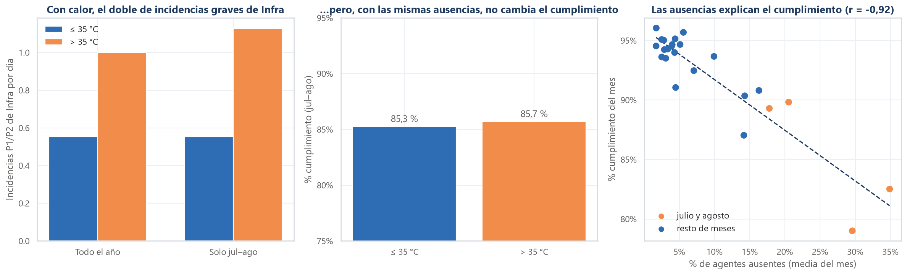
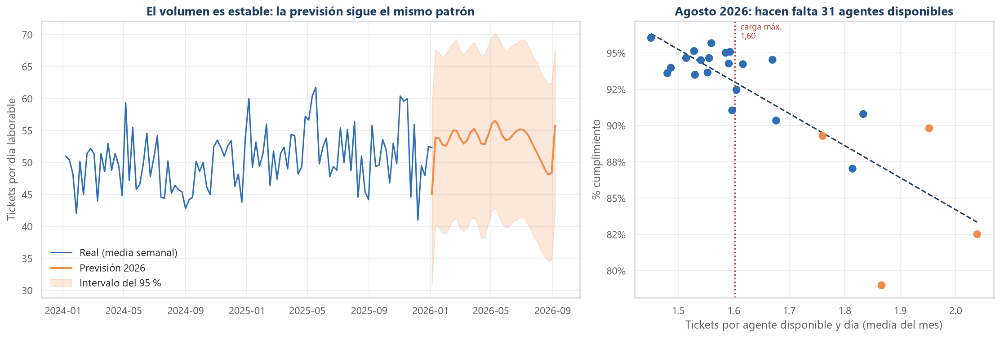
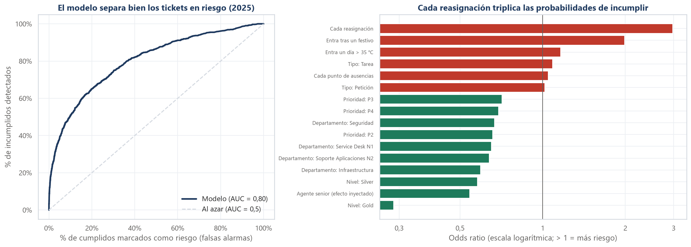
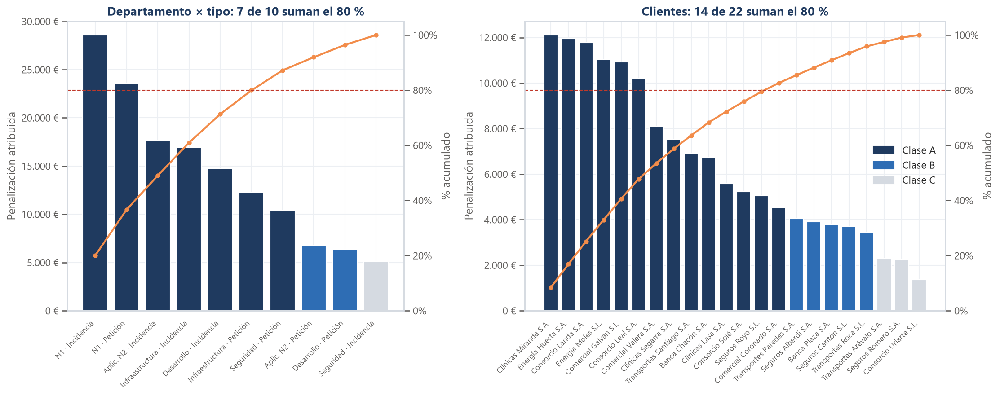
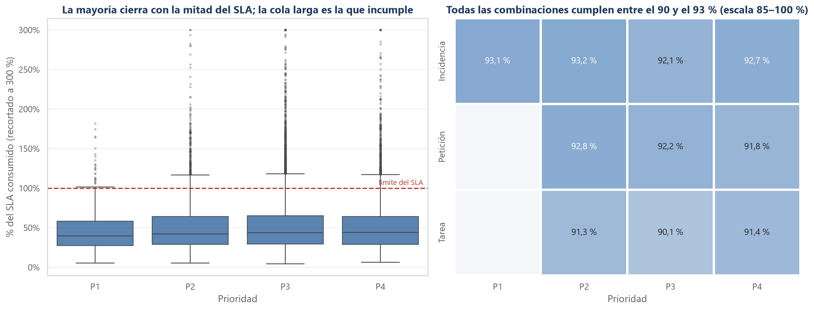
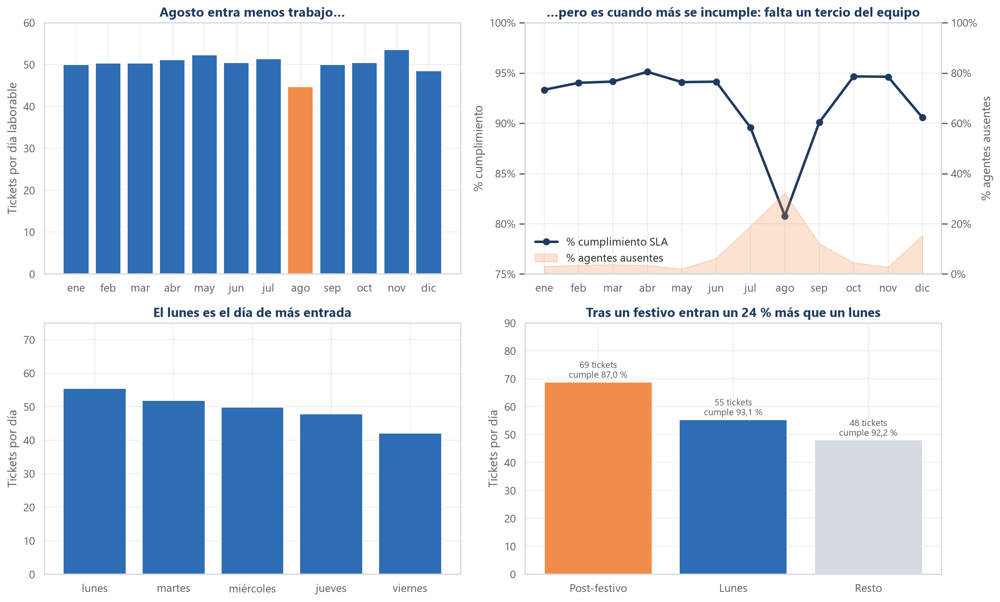
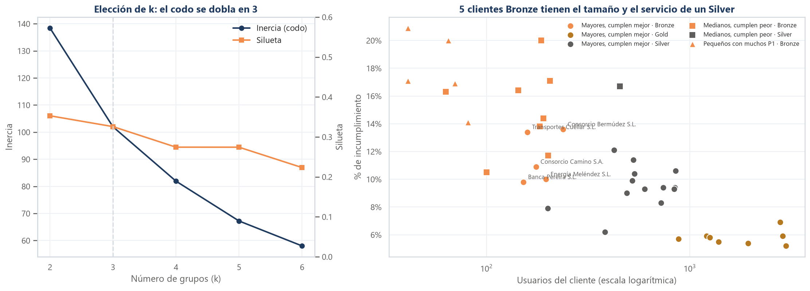

# Hallazgos · Brújula Soporte IT · Service Desk SLA Analytics

> **Contexto.** Brújula Soporte IT es una empresa **ficticia**: los tickets, clientes y agentes son
> sintéticos (generador con semilla fija), y el **clima** (Open-Meteo) y los **festivos** (Nager.Date +
> BOCM) de Madrid son **reales**. Periodo: 2024–2025, 25.300 tickets, 40 clientes, 35 agentes, sprints de
> 3 semanas. Las cifras en € llevan el tope del contrato (−3,5 % / +3 % por cliente y sprint).
> Análisis completo y reproducible en [`04_analysis/eda_completo.ipynb`](../04_analysis/eda_completo.ipynb).

## Resumen ejecutivo

En dos años, Brújula facturó **10,97 M€** y cerró con un balance de SLA de **−68.066 €** (−0,62 % de la
cuota): 74.447 € de bonus frente a 142.513 € de penalización. La pérdida no viene de un mal servicio
general (el 92 % de los tickets cumple y la mediana gasta menos de la mitad del SLA), sino de **tres
palancas operativas**:

1. **Las vacaciones de verano**, no el calor: el cumplimiento cae al 79–83 % en agosto porque falta un
   tercio del equipo. Con **4 agentes de vacaciones como máximo a la vez** se sostendría un 93 %.
2. **Las reasignaciones**: cada una **triplica** las probabilidades de incumplir. Un modelo de riesgo
   (AUC 0,80) permite vigilar a diario el 10 % de tickets que concentra casi la mitad de los incumplimientos.
3. **Los días después de un festivo**: entra un 24 % más de trabajo que un lunes y el riesgo se duplica.

El riesgo financiero está en los **clientes Gold y Silver** (objetivos del 95 % y 90 %): 7 de 8 Gold
quedaron por debajo de su objetivo en 2025, aunque son los que mejor servicio reciben.

---

## Hallazgo 1 — El SLA de verano lo decide la plantilla, no el calor

**Dato:**

| | Todo el año | Solo julio y agosto (mismas ausencias) |
|---|---|---|
| % de agentes ausentes (días > 35 °C / ≤ 35 °C) | 21,5 % / 7,4 % | 25,4 % / 25,6 % |
| Incidencias P1/P2 de Infraestructura por día | 1,00 / 0,55 | **1,13 / 0,55** (p = 0,003) |
| % de cumplimiento del SLA | 87,5 % / 92,8 % | **85,7 % / 85,3 %** |

Mes a mes, el % de ausentes y el cumplimiento se mueven juntos (**r = −0,92**, 24 meses). En una regresión
con ausencias y días de calor a la vez (R² = 0,85), **cada punto de ausencias resta 0,48 puntos de
cumplimiento (p < 0,001)** y el calor no tiene efecto propio (p = 0,31).

**Interpretación:** comparando todo el año, el calor parece dañino, pero es una **variable de
confusión**: los días de calor son también los días de vacaciones. Con las mismas ausencias, el calor
**duplica las incidencias graves de Infraestructura** (servidores, refrigeración), pero el equipo las
absorbe sin perder SLA. El cumplimiento lo mueve la gente disponible.

**Acción recomendada:**
- Gestionar el SLA de verano con la **política de vacaciones** (ver hallazgo 2), no con medidas sobre el
  calor: el aire acondicionado del equipo no mejoraría el SLA.
- **Guardia de Infraestructura** los días con previsión de más de 35 °C: no por el SLA, sino porque se
  duplican las incidencias graves que sufre el cliente.

## Hallazgo 2 — En agosto caben como máximo 4 agentes de vacaciones a la vez

**Dato:** agosto es el mes con **menos** entrada (44,7 tickets por día laborable frente a ~50) y, aun así,
el **peor** en cumplimiento (80,8 %; 79,0 % en 2025, con 10,4 agentes fuera de media). El cumplimiento
mensual cae con la carga por agente disponible (R² = 0,67): para sostener un **93 %**, la carga no debe
pasar de **1,60 tickets por agente y día**. Con la previsión de Prophet para agosto de 2026
(~49 tickets/día; validado con un error medio de 6 tickets/día en el segundo semestre de 2025), hacen
falta **31 agentes disponibles de 35**.

| Cumplimiento que se quiere sostener | 90 % | 92 % | 93 % | 94 % |
|---|---|---|---|---|
| Máximo de agentes de vacaciones a la vez | 6 | 5 | 4 | 3 |

**Interpretación:** el problema de agosto es de **capacidad, no de demanda**. Es planificable: el volumen
es estable y previsible (primer trimestre de 2026: ~3.400 tickets, IC 95 % 2.520–4.276).

**Acción recomendada:**
- Fijar un **cupo de vacaciones simultáneas en agosto** (4 para un 93 %) o cubrir el exceso con refuerzo
  temporal. Responsable: dirección del Service Desk y RR. HH., antes de abrir el calendario de vacaciones.
- Revisar el cupo cada año con la previsión actualizada.

## Hallazgo 3 — Cada reasignación triplica las probabilidades de incumplir

**Dato:** en un modelo de regresión logística (entrenado con 2024, probado con 2025: **AUC 0,80**), cada
reasignación multiplica por **2,97** las probabilidades de incumplir. Los tickets atípicos (los que más
SLA consumen) tienen el **doble de escalados** (≈ 65 % frente al 33 %), y Desarrollo, que recibe los
tickets al final de la cadena, incumple **1 de cada 3** (32,7 %). Revisando solo el **10 % de tickets con
más riesgo** se encuentra el **44,5 % de los incumplimientos**.

**Interpretación:** el incumplimiento no es un problema general (la mediana gasta el 40–44 % del SLA),
sino una **cola larga** creada por las colas entre departamentos: cada reasignación vuelve a poner el
ticket a esperar con el reloj corriendo.

**Acción recomendada:**
- **Lista diaria de escalado preventivo** con los tickets de más riesgo (reasignados, entrados tras un
  festivo, clientes Gold/Silver). Al corte de los datos, los 15 primeros concentraban el 57 % de la
  penalización esperada.
- Mejorar el **triaje en N1** para reducir reasignaciones (enviar a la primera al departamento correcto).

## Hallazgo 4 — El departamento que mejor cumple es el que más penaliza *(contraintuitivo)*

**Dato:**

| Departamento | Tickets medidos | % de incumplimiento | % de la penalización |
|---|---|---|---|
| Service Desk N1 | 15.965 (65 %) | **4,3 %** (el mejor) | **36,6 %** (el que más) |
| Desarrollo | 1.030 | **32,7 %** (el peor) | 14,8 % |

**Interpretación:** es un **efecto volumen**: un % pequeño sobre muchísimos tickets da más incumplidos
(686 en N1) que un % alto sobre pocos (337 en Desarrollo). Tasa e importe responden a preguntas
distintas: la **tasa** dice dónde está roto el proceso; el **importe**, dónde está el dinero. Los P1 no
son la causa: solo suman 1.985 € de los 142.513 € de penalización (1,4 %).

**Acción recomendada:**
- Para el **dinero**: mejoras pequeñas en N1 rinden mucho (1 punto menos de incumplimiento ≈ 160 tickets
  al año).
- Para el **proceso**: revisar la cadena de escalados hacia Desarrollo (hallazgo 3).

## Hallazgo 5 — Gold recibe el mejor servicio y aun así no llega a su objetivo

**Dato:** Gold cumple entre el 92 y el 96 % (más que cualquier otro nivel), pero su objetivo es el
**95 %**: **7 de 8 clientes Gold** quedaron por debajo en 2025 (4 de 8 en 2024). El 43 % de sus sprints cae
en tramo deficiente y otro **18 % queda al borde** (a menos de 1 punto). No hay un «80/20»: hacen falta
**14 de 22** clientes para sumar el 80 % de la penalización, y son **los 8 Gold y 6 Silver**.

**Interpretación:** la pérdida no está concentrada en unos pocos clientes problemáticos; la marca el
**nivel de contrato**: el objetivo del 95 % es muy exigente para el servicio actual. Bronze nunca penaliza
por contrato, así que no aparece en la factura aunque incumpla más.

**Acción recomendada:**
- **Alerta de sprints «al borde»** en Gold y Silver antes del cierre de cada sprint (un empujón a tiempo
  evita caer de tramo).
- Valorar en la próxima renovación si el objetivo del 95 % es sostenible con la plantilla actual o si
  hay que reforzar la cola Gold.

## Hallazgo 6 — Tras un festivo entra un 24 % más de trabajo y se cumple peor

**Dato:** el primer día laborable tras un festivo entran **69 tickets** frente a 55 un lunes normal
(**+24 %**; Mann-Whitney p = 3·10⁻⁵ con 19 días post-festivo). Los tickets de ese día cumplen el
**87,0 %** frente al 93,1 % de un lunes, y en el modelo de riesgo entrar tras un festivo **duplica** las
probabilidades de incumplir.

**Interpretación:** la cola se acumula mientras no se atiende; ese día y el siguiente se trabaja con
retraso. Es un efecto **predecible**: los festivos se conocen con un año de antelación.

**Acción recomendada:** **reforzar el turno** el primer día laborable tras cada festivo y puente (sin
vacaciones ese día), con prioridad en los tickets de Gold y Silver.

## Hallazgo 7 — Cinco clientes Bronze ya reciben un servicio de Silver

**Dato:** agrupando a los clientes solo por cómo usan el servicio (K-Means, 3 grupos; silueta 0,33,
estructura débil), **5 clientes Bronze** caen en el grupo de los Gold y Silver: tienen **152–238 usuarios**
(un Silver empieza en 200) y un incumplimiento del 10–14 %, como los Silver. Aparte, 5 Bronze pequeños
tienen un **4,2 % de P1**, más del doble que el resto.

**Interpretación:** su contrato no se ajusta a su uso real: reciben un servicio de Silver pagando Bronze
y sin compromiso de SLA. Los perfiles son débiles, así que es una pista para revisar caso a caso, no una
segmentación cerrada.

**Acción recomendada:**
- **Account management:** proponer a esos 5 clientes pasar a Silver (más cuota y un SLA acorde al uso).
- Revisar los Bronze con muchos P1: o son urgencias reales que justifican otro contrato, o se está
  clasificando mal la prioridad.

---

## Honestidad del análisis

- Los datos de negocio son **sintéticos** y el generador inyecta 6 correlaciones conocidas (Ficha §2.3).
  Este análisis demuestra que el pipeline las **detecta y las mide bien**: post-festivo, calor →
  Infraestructura, saturación, coste del escalado, prioridad de Gold y vacaciones de verano.
- **Efecto inyectado que no es un hallazgo:** los agentes senior incumplen menos (odds ratio 0,54)
  porque el generador los hace un ~18 % más rápidos.
- **Resultados débiles, reportados como tales:** el calor no tiene efecto propio sobre el cumplimiento;
  los perfiles de cliente tienen una estructura débil (silueta 0,33); el volumen por usuario es casi
  igual en todos los clientes (el generador lo reparte en proporción a los usuarios).
- **Límites:** solo 2 años de historia (estacionalidad anual poco identificada en Prophet); sin
  festivos de 2026; la relación carga → cumplimiento es una correlación mensual (24 puntos), no un
  experimento; la penalización por ticket es una **regla de atribución** (reparto a partes iguales entre
  los incumplidos de cada cliente × sprint).
