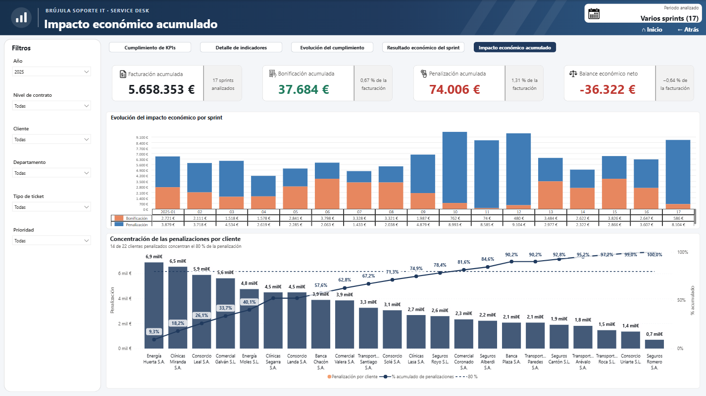
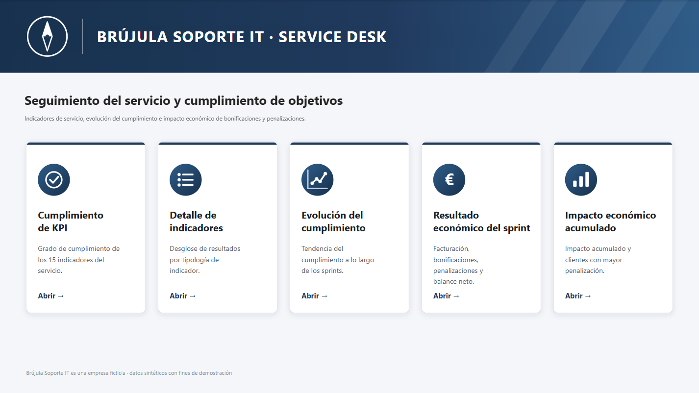
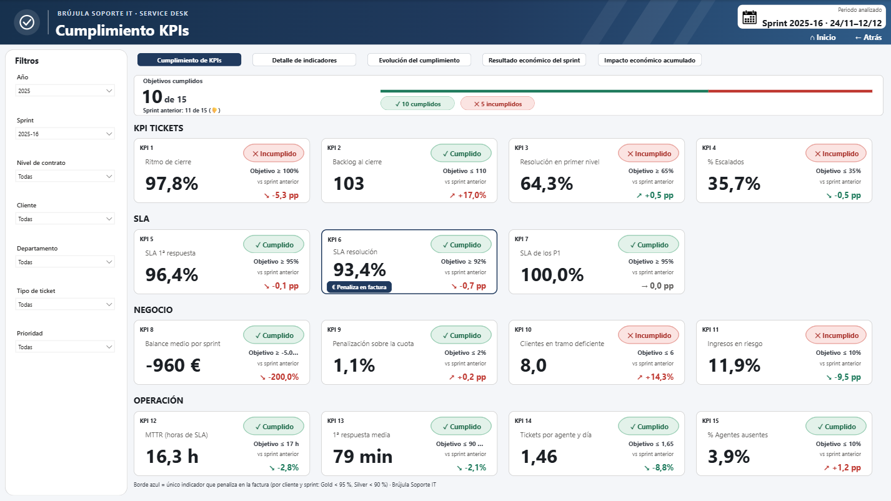
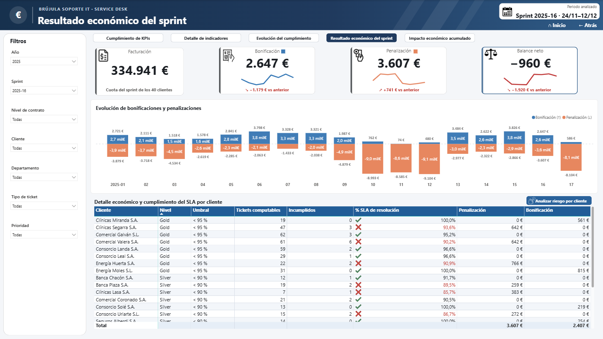
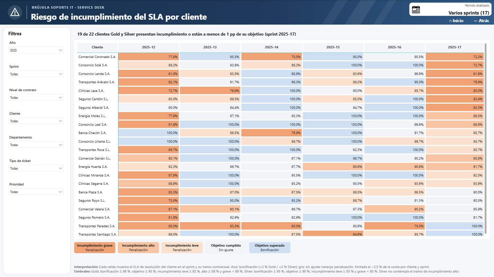

# Brújula Soporte IT — Service Desk SLA Analytics


Análisis del **cumplimiento del SLA** de un service desk B2B en España: cuánto se gana y se pierde en la
factura por las bonificaciones y penalizaciones de los contratos, y qué lo explica (escalados,
vacaciones de verano, festivos y calor).

Cubre el ciclo completo: **APIs reales → ETL en Python → modelo en PostgreSQL → informe en Power BI →
análisis en Python → hallazgos accionables**.

> **Stack:** Python (pandas, scikit-learn, statsmodels, Prophet) · PostgreSQL 16 · Power BI (TMDL/PBIR, DAX) · Jupyter · Git



## Preguntas de negocio

| # | Pregunta | Técnica | Resultado |
|---|---|---|---|
| 1 | ¿Qué % de tickets cumple el SLA y qué clientes no llegan a su objetivo? | Descriptivo, % de SLA consumido, IQR | **92 %** cumple, pero **7 de 8 clientes Gold** quedaron por debajo de su 95 % en 2025 |
| 2 | ¿Cuál es el balance económico y dónde se concentra la penalización? | Pareto ABC | **−68.066 €** en 2 años (−0,62 % de 10,97 M€); no hay 80/20: **14 de 22** clientes suman el 80 % |
| 3 | ¿Los festivos y el calor cambian el volumen y el cumplimiento? | Mann-Whitney, regresión, control de la variable de confusión | Tras un festivo entra un **24 % más**; el calor **duplica** las incidencias de Infraestructura pero **no** mueve el SLA |
| 4 | ¿Cuántos tickets entrarán y cuántos agentes hacen falta en agosto? | Prophet (validado: error medio 6 tickets/día) | ~**3.400** tickets en el T1 2026; en agosto, **máximo 4 agentes de vacaciones a la vez** para sostener un 93 % |
| 5 | ¿Qué tickets abiertos tienen más riesgo de incumplir? | Regresión logística (**AUC 0,80**) | Cada reasignación **triplica** el riesgo; el 10 % de tickets de más riesgo contiene el **44,5 %** de los incumplimientos |
| 6 | ¿Qué perfiles de cliente hay y quién no encaja en su contrato? | K-Means (k = 3) | **5 clientes Bronze** tienen el tamaño y el servicio de un Silver |

**Documentación:** [business case](05_docs/business_case.md) (contexto, contratos y limitaciones) ·
[hallazgos](05_docs/insights_findings.md) · [diccionario de datos](05_docs/data_dictionary.md) ·
[cuaderno de análisis](04_analysis/eda_completo.ipynb)

## Principales hallazgos

Detalle completo, con datos, interpretación y acción, en [`05_docs/insights_findings.md`](05_docs/insights_findings.md).

- **r = −0,92** entre las ausencias del equipo y el cumplimiento mensual: el SLA de verano lo decide la
  **plantilla**, no el calor (con las mismas ausencias, los días de más de 35 °C cumplen igual).
- **4 agentes** de vacaciones a la vez como máximo en agosto: con 10 fuera, en 2025 se cumplió solo el 79 %.
- **×3** las probabilidades de incumplir por cada reasignación entre departamentos.
- **36,6 %** de la penalización la acumula Service Desk N1, el departamento que **mejor** cumple
  (4,3 % de incumplimiento): es un efecto volumen.
- **+24 %** de tickets el día después de un festivo, que además cumplen peor (87,0 % frente a 93,1 %).
- **5 clientes Bronze** reciben un servicio de Silver sin pagarlo: candidatos a subir de nivel.

## El informe de Power BI

8 páginas con navegación guiada desde una portada, cinta común y botones de Inicio y Atrás.

| | |
|---|---|
|  |  |
| **Portada** | **Cumplimiento de los 15 KPI** frente a su objetivo |
|  |  |
| **Resultado económico del sprint** | **Riesgo por cliente**, sprint a sprint |

Resto de páginas en [`03_powerbi/screenshots/`](03_powerbi/screenshots/).

## Modelo de datos

Esquema en estrella en PostgreSQL (`servicedesk`): **12 tablas, 7 vistas, 30 índices, 3 procedimientos
y 1 función**, con unas 40 restricciones `CHECK` que hacen cumplir las reglas del negocio (por ejemplo,
«P1 solo existe para incidencias»).

```
  dim_cliente    dim_sla    dim_departamento    dim_agente ── agente_ausencia
       │            │              │                 │
       └────────────┴─────── fact_ticket ────────────┘
       │                         │    └── fact_ticket_estado (historial de estados)
       │                         │        (sprint de apertura y de medición)
       │     dim_tiempo ──── dim_sprint
       │         │               │
       │  dim_clima_madrid       │
       └──────────────── fact_facturacion_sprint (cliente × sprint) ── dim_tramo_ajuste
```

Las vistas (`v_ticket_enriquecido`, `v_cumplimiento_sprint`, `v_facturacion_sprint`,
`v_liquidacion_anual`, `v_kpis_diarios`, `v_pareto_penalizacion`, `v_perfil_cliente`) son la única
definición de cada cifra: las usan tanto Power BI como el análisis en Python.
Diccionario completo en [`05_docs/data_dictionary.md`](05_docs/data_dictionary.md).

## Estructura del proyecto

```
servicedesk-sla-analytics-spain/
├── 00_setup/              verificar_entorno.py: comprueba Python, librerías, PostgreSQL y APIs
├── 01_etl/                extracción de APIs, generador sintético, reloj de SLA, carga y verificación
├── 02_sql/                esquema, vistas, procedimientos y consultas de negocio comentadas
├── 03_powerbi/            informe en formato PBIP (modelo TMDL + informe PBIR), PBIX y capturas
│   └── _generadores/      scripts que generan el modelo y partes del informe
├── 04_analysis/           eda_completo.ipynb y sus gráficos en outputs/
├── 05_docs/               business_case.md, data_dictionary.md, insights_findings.md
├── data/
│   ├── manual/            correcciones de festivos locales (BOCM)
│   └── raw/               CSV generados (los de hechos no se versionan: se regeneran)
├── FICHA.md               decisiones del proyecto: reglas del SLA, contratos, preguntas
├── SETUP.md               instalación paso a paso y problemas resueltos
└── PROGRESO.md            bitácora del proyecto
```

## Puesta en marcha

Requisitos: Windows, Python 3.12, PostgreSQL 16 y Power BI Desktop. Detalle en [`SETUP.md`](SETUP.md).

1. **Clonar y crear el entorno**
   ```powershell
   git clone https://github.com/Merygonzalezisasa/servicedesk-sla-analytics-spain.git
   cd servicedesk-sla-analytics-spain
   py -3.12 -m venv .venv; .venv\Scripts\Activate.ps1; pip install -r requirements.txt
   ```
2. **Crear la base de datos** (usuario `analista`, base `servicedesk_sla`; ver `SETUP.md` §3) y copiar
   `.env.example` a `.env` con la contraseña.
3. **Comprobar el entorno**
   ```powershell
   python 00_setup\verificar_entorno.py
   ```
4. **Extraer, generar, cargar y verificar los datos**
   ```powershell
   python 01_etl\extract_festivos.py; python 01_etl\extract_clima.py
   python 01_etl\generate_tickets_data.py
   python 01_etl\load_to_postgres.py; python 01_etl\verificar_carga.py
   ```
5. **Crear el modelo y facturar los sprints** (si `psql` no está en el PATH, usar
   `& "C:\Program Files\PostgreSQL\16\bin\psql.exe"`)
   ```powershell
   foreach ($f in "01_create_schema","02_create_views","03_stored_procedures") { psql -U analista -d servicedesk_sla -f "02_sql\$f.sql" }
   psql -U analista -d servicedesk_sla -c "CALL servicedesk.sp_calcular_facturacion_anio(2024); CALL servicedesk.sp_calcular_facturacion_anio(2025);"
   ```
6. **Abrir el informe y el análisis**: `03_powerbi\Brujula SLA.pbip` en Power BI Desktop (parámetros
   `Servidor` = `localhost:5432` y `Base de datos` = `servicedesk_sla`, credenciales de `analista` y
   **Actualizar**), y `04_analysis\eda_completo.ipynb` en VS Code o Jupyter.

Sin PostgreSQL se puede ver igualmente el informe abriendo `03_powerbi\Brujula SLA.pbix`, que incluye
los datos.

## Actualización periódica

Cuando hay datos nuevos de contexto (clima) o se cierra un sprint:

```powershell
python 01_etl\extract_clima.py; python 01_etl\load_to_postgres.py
psql -U analista -d servicedesk_sla -c "CALL servicedesk.sp_refrescar_contexto(); CALL servicedesk.sp_calcular_facturacion_sprint('2025-17');"
```

El procedimiento de facturación no recalcula un sprint ya facturado (salvo `p_forzar => true`), igual
que una factura cerrada. En producción, estos pasos se programarían con el Programador de tareas de
Windows o con un orquestador como Airflow.

## Herramientas y técnicas

| Área | Herramientas |
|---|---|
| Extracción | Python, `requests` con reintentos · APIs Open-Meteo y Nager.Date |
| Generación de datos | Python, `numpy`/`pandas` con semilla fija · reloj de SLA laboral y 24x7 propio |
| Base de datos | PostgreSQL 16 · esquema en estrella, `CHECK`, vistas, procedimientos, *upsert* |
| BI | Power BI (PBIP: TMDL + PBIR) · DAX · Power Query (M) |
| Análisis | Jupyter · pandas · SciPy · statsmodels · scikit-learn (K-Means, regresión logística) · Prophet |
| Calidad | Verificador de carga con prueba de sabotaje · validación temporal de los modelos |

## Autora

**Rosmary González** · Analista de datos
[LinkedIn](https://www.linkedin.com/in/rosmary-gonzalez-isasa) · [GitHub](https://github.com/Merygonzalezisasa)

---

*Brújula Soporte IT es una **empresa ficticia** y no representa a ninguna organización real. Los
tickets, clientes, agentes, vacaciones y contratos son **sintéticos** (generados con reglas de SLA
habituales y semilla fija, reproducibles). El **clima diario de Madrid**
([Open-Meteo](https://open-meteo.com/)) y los **festivos nacionales y de la Comunidad de Madrid**
([Nager.Date](https://date.nager.at/) y BOCM) son **reales**.*
